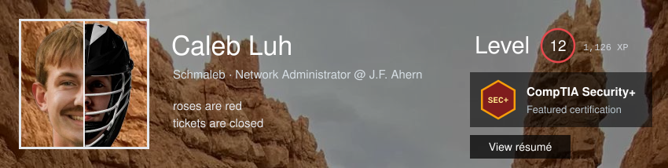
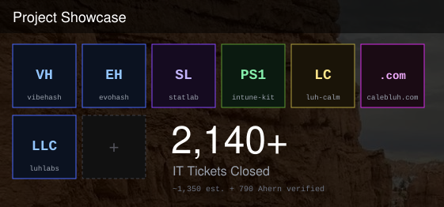
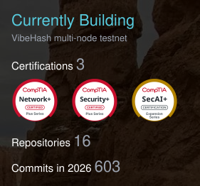
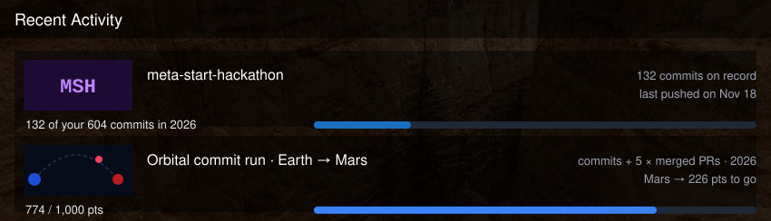
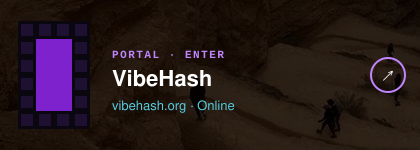
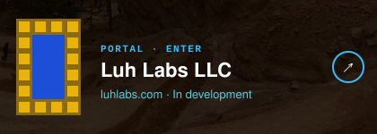
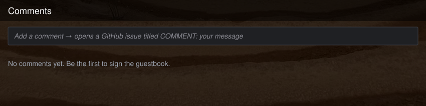
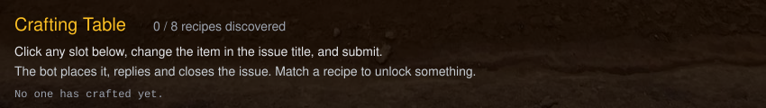

 

 

<!--START_CRAFTING-->

<a href="https://github.com/calebluh/calebluh/issues/new?title=CRAFT%3A%20iron_ingot%20-%3E%201&body=Just%20submit%20this%20issue%2C%20the%20title%20does%20the%20work.%0A%0AFormat%3A%20%60CRAFT%3A%20%3Citem%3E%20-%3E%20%3Cslot%201-9%3E%60%20%28slots%20go%20left%20to%20right%2C%20top%20to%20bottom%29.%0AItems%3A%20%60iron_ingot%60%2C%20%60stick%60%2C%20%60gold_ingot%60%2C%20%60diamond%60%2C%20%60redstone%60%2C%20%60planks%60%2C%20%60cobblestone%60%2C%20%60string%60%2C%20or%20%60air%60%20to%20clear%20a%20slot.%0A"></a><a href="https://github.com/calebluh/calebluh/issues/new?title=CRAFT%3A%20iron_ingot%20-%3E%202&body=Just%20submit%20this%20issue%2C%20the%20title%20does%20the%20work.%0A%0AFormat%3A%20%60CRAFT%3A%20%3Citem%3E%20-%3E%20%3Cslot%201-9%3E%60%20%28slots%20go%20left%20to%20right%2C%20top%20to%20bottom%29.%0AItems%3A%20%60iron_ingot%60%2C%20%60stick%60%2C%20%60gold_ingot%60%2C%20%60diamond%60%2C%20%60redstone%60%2C%20%60planks%60%2C%20%60cobblestone%60%2C%20%60string%60%2C%20or%20%60air%60%20to%20clear%20a%20slot.%0A"></a><a href="https://github.com/calebluh/calebluh/issues/new?title=CRAFT%3A%20iron_ingot%20-%3E%203&body=Just%20submit%20this%20issue%2C%20the%20title%20does%20the%20work.%0A%0AFormat%3A%20%60CRAFT%3A%20%3Citem%3E%20-%3E%20%3Cslot%201-9%3E%60%20%28slots%20go%20left%20to%20right%2C%20top%20to%20bottom%29.%0AItems%3A%20%60iron_ingot%60%2C%20%60stick%60%2C%20%60gold_ingot%60%2C%20%60diamond%60%2C%20%60redstone%60%2C%20%60planks%60%2C%20%60cobblestone%60%2C%20%60string%60%2C%20or%20%60air%60%20to%20clear%20a%20slot.%0A"></a> 
<a href="https://github.com/calebluh/calebluh/issues/new?title=CRAFT%3A%20iron_ingot%20-%3E%204&body=Just%20submit%20this%20issue%2C%20the%20title%20does%20the%20work.%0A%0AFormat%3A%20%60CRAFT%3A%20%3Citem%3E%20-%3E%20%3Cslot%201-9%3E%60%20%28slots%20go%20left%20to%20right%2C%20top%20to%20bottom%29.%0AItems%3A%20%60iron_ingot%60%2C%20%60stick%60%2C%20%60gold_ingot%60%2C%20%60diamond%60%2C%20%60redstone%60%2C%20%60planks%60%2C%20%60cobblestone%60%2C%20%60string%60%2C%20or%20%60air%60%20to%20clear%20a%20slot.%0A"></a><a href="https://github.com/calebluh/calebluh/issues/new?title=CRAFT%3A%20iron_ingot%20-%3E%205&body=Just%20submit%20this%20issue%2C%20the%20title%20does%20the%20work.%0A%0AFormat%3A%20%60CRAFT%3A%20%3Citem%3E%20-%3E%20%3Cslot%201-9%3E%60%20%28slots%20go%20left%20to%20right%2C%20top%20to%20bottom%29.%0AItems%3A%20%60iron_ingot%60%2C%20%60stick%60%2C%20%60gold_ingot%60%2C%20%60diamond%60%2C%20%60redstone%60%2C%20%60planks%60%2C%20%60cobblestone%60%2C%20%60string%60%2C%20or%20%60air%60%20to%20clear%20a%20slot.%0A"></a><a href="https://github.com/calebluh/calebluh/issues/new?title=CRAFT%3A%20iron_ingot%20-%3E%206&body=Just%20submit%20this%20issue%2C%20the%20title%20does%20the%20work.%0A%0AFormat%3A%20%60CRAFT%3A%20%3Citem%3E%20-%3E%20%3Cslot%201-9%3E%60%20%28slots%20go%20left%20to%20right%2C%20top%20to%20bottom%29.%0AItems%3A%20%60iron_ingot%60%2C%20%60stick%60%2C%20%60gold_ingot%60%2C%20%60diamond%60%2C%20%60redstone%60%2C%20%60planks%60%2C%20%60cobblestone%60%2C%20%60string%60%2C%20or%20%60air%60%20to%20clear%20a%20slot.%0A"></a> 
<a href="https://github.com/calebluh/calebluh/issues/new?title=CRAFT%3A%20iron_ingot%20-%3E%207&body=Just%20submit%20this%20issue%2C%20the%20title%20does%20the%20work.%0A%0AFormat%3A%20%60CRAFT%3A%20%3Citem%3E%20-%3E%20%3Cslot%201-9%3E%60%20%28slots%20go%20left%20to%20right%2C%20top%20to%20bottom%29.%0AItems%3A%20%60iron_ingot%60%2C%20%60stick%60%2C%20%60gold_ingot%60%2C%20%60diamond%60%2C%20%60redstone%60%2C%20%60planks%60%2C%20%60cobblestone%60%2C%20%60string%60%2C%20or%20%60air%60%20to%20clear%20a%20slot.%0A"></a><a href="https://github.com/calebluh/calebluh/issues/new?title=CRAFT%3A%20iron_ingot%20-%3E%208&body=Just%20submit%20this%20issue%2C%20the%20title%20does%20the%20work.%0A%0AFormat%3A%20%60CRAFT%3A%20%3Citem%3E%20-%3E%20%3Cslot%201-9%3E%60%20%28slots%20go%20left%20to%20right%2C%20top%20to%20bottom%29.%0AItems%3A%20%60iron_ingot%60%2C%20%60stick%60%2C%20%60gold_ingot%60%2C%20%60diamond%60%2C%20%60redstone%60%2C%20%60planks%60%2C%20%60cobblestone%60%2C%20%60string%60%2C%20or%20%60air%60%20to%20clear%20a%20slot.%0A"></a><a href="https://github.com/calebluh/calebluh/issues/new?title=CRAFT%3A%20iron_ingot%20-%3E%209&body=Just%20submit%20this%20issue%2C%20the%20title%20does%20the%20work.%0A%0AFormat%3A%20%60CRAFT%3A%20%3Citem%3E%20-%3E%20%3Cslot%201-9%3E%60%20%28slots%20go%20left%20to%20right%2C%20top%20to%20bottom%29.%0AItems%3A%20%60iron_ingot%60%2C%20%60stick%60%2C%20%60gold_ingot%60%2C%20%60diamond%60%2C%20%60redstone%60%2C%20%60planks%60%2C%20%60cobblestone%60%2C%20%60string%60%2C%20or%20%60air%60%20to%20clear%20a%20slot.%0A"></a>

<!--END_CRAFTING-->

