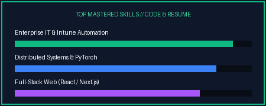
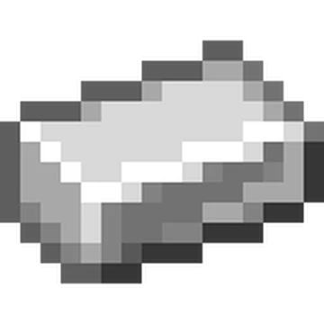
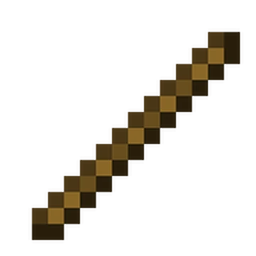
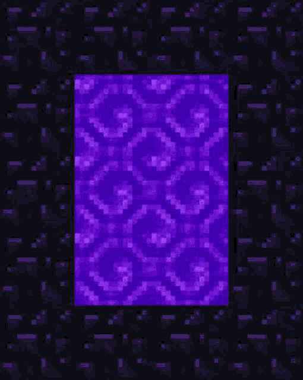

<!-- ==================== ROW 1: SPLIT-FACE HERO BANNER ==================== -->

  

 

<!-- ==================== ROW 2: ROCKET DISTANCE & TOP SKILLS ==================== -->

  <table width="100%" border="0" cellspacing="0" cellpadding="8">
    <tr>
      <!-- Left: Orbital Rocket Commit Distance Chart -->
      <td width="50%" align="center" valign="top" bgcolor="#030712">
        
      </td>
      <!-- Right: Top Skills Mastered (Code & Resume) -->
      <td width="50%" align="center" valign="top" bgcolor="#030712">
        
      </td>
    </tr>
  </table>

 

<!-- ==================== ROW 3: ALL-TIME TICKETS CLOSED ==================== -->

  

 

<!-- ==================== ROW 4: THE README CRAFTING TABLE GAME ==================== -->

  <table width="100%" border="0" cellspacing="0" cellpadding="12" style="background: #18181B; border: 2px solid #52525B; border-radius: 10px;">
    <tr>
      <td align="center">
        <h3 style="color: #FBBF24; font-family: monospace; margin: 0;">🕹️ INTERACTIVE README CRAFTING TABLE</h3>
        

          Combine items via GitHub Issues to craft secret project blueprints &amp; unlock hidden profile rooms!
        

        <!-- 3x3 Crafting Grid UI -->
        <table border="1" bordercolor="#3F3F46" cellspacing="0" cellpadding="8" style="background: #09090B; border-radius: 6px;">
          <tr>
            <td align="center" width="52" height="52">
              
            </td>
            <td align="center" width="52" height="52">
              
            </td>
            <td align="center" width="52" height="52">
              
            </td>
          </tr>
          <tr>
            <td align="center" width="52" height="52"></td>
            <td align="center" width="52" height="52">
              
            </td>
            <td align="center" width="52" height="52"></td>
          </tr>
          <tr>
            <td align="center" width="52" height="52"></td>
            <td align="center" width="52" height="52">
              
            </td>
            <td align="center" width="52" height="52"></td>
          </tr>
        </table>
         
        
      </td>
    </tr>
  </table>

 

<!-- ==================== ROW 5: PORTALS (USING YOUR UPLOADED GIF) ==================== -->

  <table width="100%" border="0" cellspacing="0" cellpadding="8">
    <tr>
      <!-- Left Portal -> VibeHash -->
      <td width="50%" align="center" valign="top" bgcolor="#0D0714">
        <b style="color: #C084FC; font-family: monospace;">PORTAL TO VIBE HASH</b>  
        
      </td>
      <!-- Right Portal -> Luh Labs LLC -->
      <td width="50%" align="center" valign="top" bgcolor="#071318">
        <b style="color: #38BDF8; font-family: monospace;">PORTAL TO LUH LABS LLC</b>  
        
      </td>
    </tr>
  </table>

