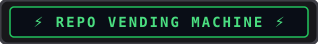
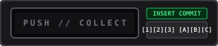
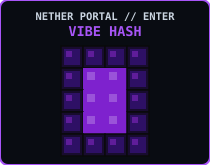
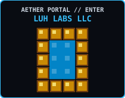

import json
import os
import re
import urllib.request

USERNAME = "calebluh"
TOKEN = os.environ.get("GITHUB_TOKEN", "")
HUD_DIR = "assets/hud"
os.makedirs(HUD_DIR, exist_ok=True)

def gh_get(url):
    req = urllib.request.Request(url)
    req.add_header("Accept", "application/vnd.github+json")
    if TOKEN:
        req.add_header("Authorization", f"Bearer {TOKEN}")
    with urllib.request.urlopen(req) as resp:
        return json.loads(resp.read().decode())

# 1. Fetch top 9 non-fork public repos
repos_raw = gh_get(f"https://api.github.com/users/{USERNAME}/repos?sort=pushed&per_page=25")
repos = [r for r in repos_raw if not r.get("fork")][:9]
while len(repos) < 9:
    repos.append({"name": "coming-soon", "html_url": f"https://github.com/{USERNAME}"})

# 2. Vending Machine Top Marquee & Bottom Chute
vm_top = """<svg width="318" height="44" viewBox="0 0 318 44" xmlns="http://www.w3.org/2000/svg">
  <rect width="318" height="44" rx="8" fill="#18181B" stroke="#3F3F46" stroke-width="3"/>
  <rect x="10" y="7" width="298" height="30" rx="4" fill="#090D16" stroke="#22C55E" stroke-width="1.5"/>
  <text x="159" y="27" text-anchor="middle" fill="#4ADE80" font-family="monospace" font-size="14" font-weight="900" letter-spacing="2">
    ⚡ REPO VENDING MACHINE ⚡
  </text>
</svg>"""
with open(f"{HUD_DIR}/vm_top.svg", "w") as f:
    f.write(vm_top)

vm_bottom = """<svg width="318" height="68" viewBox="0 0 318 68" xmlns="http://www.w3.org/2000/svg">
  <rect width="318" height="68" rx="8" fill="#18181B" stroke="#3F3F46" stroke-width="3"/>
  <!-- Delivery Chute Flap -->
  <rect x="16" y="12" width="186" height="44" rx="5" fill="#09090B" stroke="#52525B" stroke-width="2"/>
  <rect x="22" y="18" width="174" height="32" rx="3" fill="#121215"/>
  <text x="109" y="38" text-anchor="middle" fill="#71717A" font-family="monospace" font-size="12" font-weight="800" letter-spacing="3">PUSH // COLLECT</text>
  <!-- Digital LED & Keypad -->
  <rect x="214" y="12" width="88" height="16" rx="2" fill="#052E16" stroke="#22C55E" stroke-width="1"/>
  <text x="258" y="23" text-anchor="middle" fill="#4ADE80" font-family="monospace" font-size="9" font-weight="700">INSERT COMMIT</text>
  <rect x="214" y="32" width="88" height="24" rx="3" fill="#27272A" stroke="#52525B"/>
  <text x="258" y="47" text-anchor="middle" fill="#E4E4E7" font-family="monospace" font-size="9" font-weight="700">[1][2][3] [A][B][C]</text>
</svg>"""
with open(f"{HUD_DIR}/vm_bottom.svg", "w") as f:
    f.write(vm_bottom)

# 3. Generate 9 Realistic Vending Machine Shelf Slots (Can/Bottle + Metal Coil + Price Tag)
DRINK_THEMES = [
    ("#38BDF8", "#0369A1", "A1"), ("#A855F7", "#6B21A8", "A2"), ("#22C55E", "#15803D", "A3"),
    ("#F59E0B", "#B45309", "B1"), ("#EF4444", "#B91C1C", "B2"), ("#14B8A6", "#0F766E", "B3"),
    ("#6366F1", "#4338CA", "C1"), ("#EC4899", "#BE185D", "C2"), ("#84CC16", "#4D7C0F", "C3"),
]

for idx, repo in enumerate(repos):
    hi, lo, code = DRINK_THEMES[idx % len(DRINK_THEMES)]
    name = repo["name"][:12]
    slot_svg = f"""<svg width="104" height="74" viewBox="0 0 104 74" xmlns="http://www.w3.org/2000/svg">
  <!-- Dark Interior Shelf -->
  <rect width="104" height="74" fill="#0B0F17" stroke="#27272A" stroke-width="1.5"/>
  <!-- Metal Spiral Coil Behind Item -->
  <circle cx="52" cy="34" r="20" fill="none" stroke="#71717A" stroke-width="2.2" stroke-dasharray="6 4">
    <animateTransform attributeName="transform" type="rotate" from="0 52 34" to="360 52 34" dur="{9 + idx}s" repeatCount="indefinite"/>
  </circle>
  <!-- Energy Can / Repo Capsule -->
  <rect x="34" y="10" width="36" height="44" rx="7" fill="{lo}" stroke="{hi}" stroke-width="1.8"/>
  <rect x="37" y="8" width="30" height="4" rx="2" fill="#D4D4D8"/>
  <rect x="37" y="52" width="30" height="3" rx="1.5" fill="#A1A1AA"/>
  <!-- Specular Glass Highlight -->
  <rect x="39" y="14" width="5" height="34" rx="2.5" fill="#FFFFFF" opacity="0.28"/>
  <!-- Shelf Price Tag Rail -->
  <rect x="3" y="56" width="98" height="15" rx="2" fill="#18181B" stroke="#52525B" stroke-width="1"/>
  <rect x="5" y="58" width="18" height="11" rx="1.5" fill="{hi}"/>
  <text x="14" y="66.5" text-anchor="middle" fill="#09090B" font-family="monospace" font-size="8" font-weight="900">{code}</text>
  <text x="62" y="66.5" text-anchor="middle" fill="#F4F4F5" font-family="monospace" font-size="8.5" font-weight="700">{name}</text>
</svg>"""
    with open(f"{HUD_DIR}/slot_{idx}.svg", "w") as f:
        f.write(slot_svg)

# 4. Authentic CoD Barracks Calling Card + Career Telemetry
tickets_msg = "2,140+"
if os.path.exists("tickets.json"):
    with open("tickets.json") as f:
        tickets_msg = json.load(f).get("message", "2,140+").split(" ")[0]

user_data = gh_get(f"https://api.github.com/users/{USERNAME}")
public_repos_count = user_data.get("public_repos", 12)
prestige_lvl = min(10, max(1, public_repos_count // 2))

cod_svg = f"""<svg width="340" height="334" viewBox="0 0 340 334" xmlns="http://www.w3.org/2000/svg">
  <defs>
    <linearGradient id="cardPlate" x1="0" y1="0" x2="340" y2="96" gradientUnits="userSpaceOnUse">
      <stop offset="0%" stop-color="#1C241B"/>
      <stop offset="50%" stop-color="#293524"/>
      <stop offset="100%" stop-color="#111611"/>
    </linearGradient>
    <linearGradient id="goldWing" x1="0" y1="0" x2="1" y2="1">
      <stop offset="0%" stop-color="#FDE047"/>
      <stop offset="50%" stop-color="#D97706"/>
      <stop offset="100%" stop-color="#78350F"/>
    </linearGradient>
    <linearGradient id="xpFill" x1="0" y1="0" x2="1" y2="0">
      <stop offset="0%" stop-color="#D97706"/>
      <stop offset="100%" stop-color="#FACC15"/>
    </linearGradient>
  </defs>

  <!-- Outer Military Frame -->
  <rect x="2" y="2" width="336" height="330" rx="8" fill="#0B0F0B" stroke="#4B5543" stroke-width="2"/>

  <!-- CoD Calling Card Top Plate -->
  <rect x="10" y="10" width="320" height="94" rx="5" fill="url(#cardPlate)" stroke="#6B7A5E" stroke-width="1.5"/>
  <!-- Diagonal Tactical Stripes -->
  <polygon points="180,10 215,10 175,104 140,104" fill="#000000" opacity="0.25"/>
  <polygon points="230,10 250,10 210,104 190,104" fill="#000000" opacity="0.25"/>

  <!-- Prestige Emblem (Wings + Star Crest + Crossed Blades) -->
  <g transform="translate(52, 56)">
    <!-- Wings -->
    <polygon points="-38,-14 -12,-6 -16,12 -34,4" fill="url(#goldWing)" stroke="#FEF08A" stroke-width="1"/>
    <polygon points="38,-14 12,-6 16,12 34,4" fill="url(#goldWing)" stroke="#FEF08A" stroke-width="1"/>
    <!-- Crossed Blades -->
    <line x1="-22" y1="-24" x2="22" y2="24" stroke="#E4E4E7" stroke-width="3.5" stroke-linecap="round"/>
    <line x1="22" y1="-24" x2="-22" y2="24" stroke="#E4E4E7" stroke-width="3.5" stroke-linecap="round"/>
    <!-- Central Octagon Medallion -->
    <polygon points="0,-22 16,-14 20,4 10,20 -10,20 -20,4 -16,-14" fill="#7F1D1D" stroke="#FDE047" stroke-width="2"/>
    <text x="0" y="5" text-anchor="middle" fill="#FEF08A" font-family="Impact, Arial Black, sans-serif" font-size="15">P{prestige_lvl}</text>
  </g>

  <!-- Gamertag & Clan Tag -->
  <rect x="102" y="18" width="46" height="20" rx="2" fill="#141814" stroke="#A3E635" stroke-width="1"/>
  <text x="125" y="32" text-anchor="middle" fill="#A3E635" font-family="monospace" font-size="11" font-weight="900">[LUH]</text>
  <text x="155" y="34" fill="#F8FAFC" font-family="Impact, Arial Black, sans-serif" font-size="21" letter-spacing="1.5">CALEB LUH</text>

  <text x="102" y="54" fill="#FACC15" font-family="monospace" font-size="12" font-weight="800">PRESTIGE {prestige_lvl} • COMMANDER LVL 55</text>
  <!-- XP Bar -->
  <rect x="102" y="61" width="214" height="11" rx="2" fill="#090D09" stroke="#52525B"/>
  <rect x="104" y="63" width="176" height="7" rx="1" fill="url(#xpFill)"/>
  <text x="102" y="88" fill="#86EFAC" font-family="monospace" font-size="10" font-weight="700">▶ CLICK FOR LIVE AI SKILL AUDIT</text>

  <!-- Barracks Combat Record -->
  <rect x="10" y="114" width="320" height="104" rx="5" fill="#101510" stroke="#3F4E37"/>
  <rect x="10" y="114" width="320" height="22" rx="4" fill="#1D261C"/>
  <text x="20" y="129" fill="#D4D4D8" font-family="monospace" font-size="11" font-weight="800" letter-spacing="1">BARRACKS // COMBAT RECORD</text>

  <text x="22" y="154" fill="#A1A1AA" font-family="monospace" font-size="12">IT TICKETS CLOSED</text>
  <text x="318" y="154" text-anchor="end" fill="#4ADE80" font-family="monospace" font-size="13" font-weight="900">{tickets_msg}</text>

  <text x="22" y="177" fill="#A1A1AA" font-family="monospace" font-size="12">ACTIVE REPOSITORIES</text>
  <text x="318" y="177" text-anchor="end" fill="#38BDF8" font-family="monospace" font-size="13" font-weight="900">{public_repos_count}</text>

  <text x="22" y="200" fill="#A1A1AA" font-family="monospace" font-size="12">CLEARANCE / CERTS</text>
  <text x="318" y="200" text-anchor="end" fill="#FACC15" font-family="monospace" font-size="11.5" font-weight="900">NET+ | SEC+ | SECAI+</text>

  <!-- Active Daily Challenges -->
  <rect x="10" y="226" width="320" height="96" rx="5" fill="#101510" stroke="#3F4E37"/>
  <rect x="10" y="226" width="320" height="22" rx="4" fill="#1D261C"/>
  <text x="20" y="241" fill="#D4D4D8" font-family="monospace" font-size="11" font-weight="800" letter-spacing="1">ACTIVE CHALLENGES</text>

  <text x="22" y="264" fill="#E4E4E7" font-family="monospace" font-size="11">☑ VIBEHASH VERIFIABLE LORA</text>
  <text x="22" y="284" fill="#E4E4E7" font-family="monospace" font-size="11">☑ STATLAB SPORTS NETWORK OS</text>
  <text x="22" y="304" fill="#E4E4E7" font-family="monospace" font-size="11">☑ INTUNE AUTOPILOT HARDENING</text>
</svg>"""

with open(f"{HUD_DIR}/cod_center.svg", "w") as f:
    f.write(cod_svg)

# 5. Pixel-Art Minecraft Nether & Aether Portals (4x5 Block Frame Geometry)
def build_portal_svg(filename, title, subtitle, frame_dark, frame_mid, frame_hi, swirl_a, swirl_b, border_col):
    # 4 blocks wide x 5 blocks tall (each block = 22x22 px)
    blocks = []
    ox, oy, bs = 61, 46, 22
    for r in range(5):
        for c in range(4):
            x, y = ox + c * bs, oy + r * bs
            is_frame = (r in (0, 4)) or (c in (0, 3))
            if is_frame:
                blocks.append(f'<rect x="{x}" y="{y}" width="{bs}" height="{bs}" fill="{frame_dark}" stroke="#09090B" stroke-width="1.5"/>')
                blocks.append(f'<rect x="{x+3}" y="{y+3}" width="{bs-6}" height="{bs-6}" fill="{frame_mid}"/>')
                blocks.append(f'<rect x="{x+5}" y="{y+5}" width="6" height="6" fill="{frame_hi}" opacity="0.8"/>')
            else:
                dur = 1.6 + ((r + c) % 3) * 0.4
                blocks.append(f'''<rect x="{x}" y="{y}" width="{bs}" height="{bs}" fill="{swirl_a}">
                  <animate attributeName="fill" values="{swirl_a};{swirl_b};{swirl_a}" dur="{dur}s" repeatCount="indefinite"/>
                </rect>''')
                blocks.append(f'<rect x="{x+4}" y="{y+4}" width="8" height="8" fill="#FFFFFF" opacity="0.22"/>')

    svg = f"""<svg width="210" height="165" viewBox="0 0 210 165" xmlns="http://www.w3.org/2000/svg">
  <rect width="210" height="165" rx="8" fill="#090C12" stroke="{border_col}" stroke-width="2"/>
  <text x="105" y="20" text-anchor="middle" fill="#CBD5E1" font-family="monospace" font-size="10.5" font-weight="800">{title}</text>
  <text x="105" y="36" text-anchor="middle" fill="{border_col}" font-family="monospace" font-size="13.5" font-weight="900">{subtitle}</text>
  {''.join(blocks)}
</svg>"""
    with open(f"{HUD_DIR}/{filename}", "w") as f:
        f.write(svg)

build_portal_svg(
    "nether_portal.svg",
    "NETHER PORTAL // ENTER",
    "VIBE HASH",
    "#180C2E", "#2E1065", "#6B21A8",
    "#7E22CE", "#C084FC", "#A855F7"
)

build_portal_svg(
    "aether_portal.svg",
    "AETHER PORTAL // ENTER",
    "LUH LABS LLC",
    "#713F12", "#CA8A04", "#FEF08A",
    "#0284C7", "#7DD3FC", "#38BDF8"
)

# 6. Auto-Inject Clickable Arcade Table into README.md
if os.path.exists("README.md"):
    with open("README.md", "r", encoding="utf-8") as f:
        readme = f.read()

    vending_rows = []
    for row in range(3):
        cells = []
        for col in range(3):
            idx = row * 3 + col
            url = repos[idx]["html_url"]
            repo_name = repos[idx]["name"]
            cells.append(f'')
        vending_rows.append("".join(cells))

    arcade_html = f"""<!--START_ARCADE-->

  <table>
    <tr>
      <td align="center" valign="top" bgcolor="#090D16">
         
        {vending_rows[0]} 
        {vending_rows[1]} 
        {vending_rows[2]} 
          
        
      </td>
      <td align="center" valign="top" bgcolor="#0B0F0B">
        
      </td>
      <td align="center" valign="top" bgcolor="#090C12">
         
        
      </td>
    </tr>
  </table>

<!--END_ARCADE-->"""

    if "<!--START_ARCADE-->" in readme and "<!--END_ARCADE-->" in readme:
        updated = re.sub(
            r"<!--START_ARCADE-->.*?<!--END_ARCADE-->",
            arcade_html,
            readme,
            flags=re.DOTALL,
        )
        with open("README.md", "w", encoding="utf-8") as f:
            f.write(updated)
