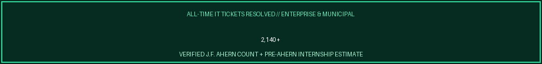

<!-- ==================== ROW 1: SPLIT-FACE HERO BANNER ==================== -->

  

 

<!-- ==================== ROW 2: ROCKET DISTANCE & TOP SKILLS ==================== -->

  <table width="100%" border="0" cellspacing="0" cellpadding="8">
    <tr>
      <!-- Left: Orbital Rocket Commit Distance Chart -->
      <td width="50%" align="center" valign="top" bgcolor="#030712">
        
      </td>
      <!-- Right: Top Skills Mastered (Code & Resume) -->
      <td width="50%" align="center" valign="top" bgcolor="#030712">
        
      </td>
    </tr>
  </table>

 

<!-- ==================== ROW 3: ALL-TIME TICKETS CLOSED ==================== -->

  

 

<!-- ==================== ROW 4: THE README CRAFTING TABLE GAME ==================== -->

  <table width="100%" border="0" cellspacing="0" cellpadding="12" style="background: #18181B; border: 2px solid #52525B; border-radius: 10px;">
    <tr>
      <td align="center">
        <h3 style="color: #FBBF24; font-family: monospace; margin: 0;">🕹️ INTERACTIVE README CRAFTING TABLE</h3>
        

          Combine items via GitHub Issues to craft secret project blueprints &amp; unlock hidden profile rooms!
        

        <!-- 3x3 Crafting Grid UI -->
        <table border="1" bordercolor="#3F3F46" cellspacing="0" cellpadding="8" style="background: #09090B; border-radius: 6px;">
          <tr>
            <td align="center" width="48" height="48" style="color: #71717A; font-family: monospace;">🪵 Wood</td>
            <td align="center" width="48" height="48" style="color:
