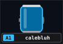
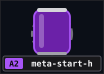
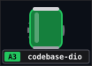
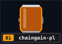
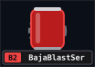
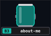
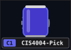
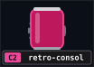
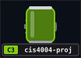
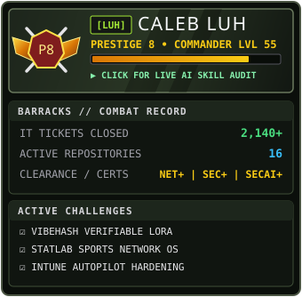

<!--START_ARCADE-->

  <table>
    <tr>
      <td align="center" valign="top" bgcolor="#090D16">
         
         
         
         
          
        
      </td>
      <td align="center" valign="top" bgcolor="#0B0F0B">
        
      </td>
      <td align="center" valign="top" bgcolor="#090C12">
         
        
      </td>
    </tr>
  </table>

<!--END_ARCADE-->
